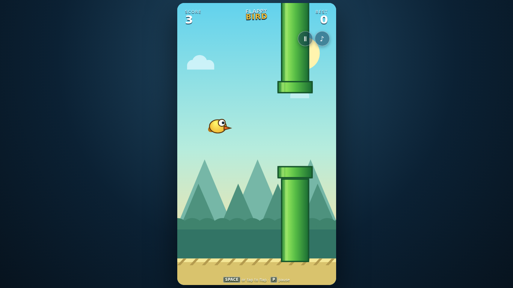

# Flappy Bird

**Play now:** https://nateofspades.github.io/flappy_bird_game/



A responsive canvas flying game built with static HTML, CSS, and vanilla JavaScript. It includes a three-second launch countdown, pause/resume, persistent best scores, high-DPI rendering, and a continuous original WebAudio soundtrack.

## Controls

### Desktop

- **Space** or click the game board: start and flap
- **P** or the pause button: pause and resume
- **Music On / Music Off**: mute or restore the background music
- **Fly again**: restart after a collision

### Mobile and tablet

- **Tap the game board**: start and flap
- **Pause / Resume**: pause and continue the current run
- **Music On / Music Off**: mute or restore the background music
- **Fly again**: restart after a collision

Fly through each pipe gap. Touching a pipe, the ceiling, or the ground ends the run. Pipe speed increases and gaps narrow as the score rises.

## Music provenance and license

**“Skyline Skip”** is an original, lighthearted 148 BPM instrumental composed specifically for this repository. It is generated at runtime by the compact sequencer in [`src/music.js`](src/music.js); no sampled audio, third-party recording, or sound-effect asset is used.

The “Skyline Skip” composition and arrangement are dedicated to the public domain under [CC0 1.0 Universal](https://creativecommons.org/publicdomain/zero/1.0/). You may copy, modify, and redistribute the music, including commercially, without attribution.

Music begins only after the first player interaction to comply with browser autoplay rules. The loop keeps its position through game states and responsive resizes. The music preference is stored locally in the browser.

## Local setup

Requires Node.js 22 or a compatible current Node.js release.

```bash
npm ci
npm run dev
```

Open the local URL printed by the development server.

## Testing

```bash
npm test
npx playwright install chromium
npm run test:e2e
```

Vitest covers deterministic gameplay, score persistence, music preferences, lifecycle recovery, duplicate prevention, and removal of event sound effects. Playwright uses one Chromium worker on port `4174` and covers keyboard, pointer, real touch emulation, music continuity and persistence, visibility/audio interruption recovery, runtime/network errors, and overflow at:

- 1920×1080
- 1366×768
- 768×1024
- 390×844
- 320×568
- 844×390

GitHub Actions runs both suites for pushes to `main` and pull requests targeting `main`.
